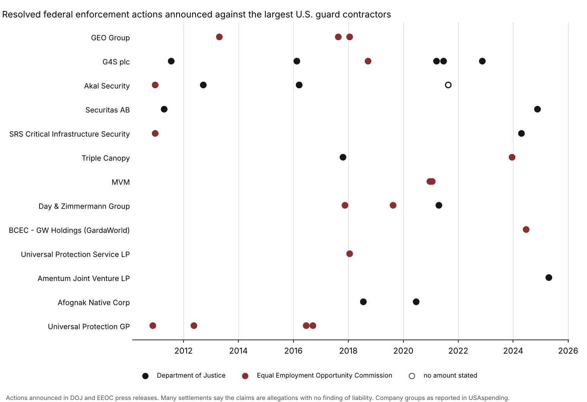

# guard-contractor-enforcement

[](https://doi.org/10.5281/zenodo.23770755)

Published by [Mercenomics](https://mercenomics.org), an independent data archive on the business of force for hire.

Federal enforcement actions against the largest U.S. government guard contractors, as announced by the Department of Justice (DOJ) and the Equal Employment Opportunity Commission (EEOC), with a check of the federal exclusions list. Every action was read by hand from the agency's own press release and keeps its link, the amount in the release's own words and what the release says about liability.

The companies covered are the 50 largest recipients of federal guard-service contracts in fiscal years 2008 to 2026, taken from the Mercenomics dataset [us-guard-spending](https://doi.org/10.5281/zenodo.23750993). Two of the 50 are USAspending placeholders, not companies, which leaves **48 company groups**.



## What it shows

- **48 actions** against 13 of the 48 company groups, announced from September 2009 to April 2025. Of these, 34 were resolved (settlements, consent decrees, a plea agreement and non-prosecution agreements) and 14 were lawsuits or complaints that were still open when announced. For 11 of the 14, the later resolution is also in the data, as a separate row.
- **Department of Justice: 17 resolved actions**, $120,957,831 in amounts stated. Ten are False Claims Act settlements, six of them over guard or security contracts. The other seven include a criminal antitrust plea, two agreements not to prosecute, and settlements over immigration-document demands on workers and a reservist's pension. Examples:
  - Paragon Systems, $52 million (2024), over small-business set-aside contracts;
  - DynCorp International, $21 million (2025), now part of Amentum;
  - G4S Secure Solutions NV, a criminal antitrust plea with a $15 million fine (2021), over bid rigging on Defense Department contracts in Belgium;
  - ArmorGroup North America, $7.5 million (2011), over the U.S. Embassy guard force in Kabul.
- **EEOC: 17 resolved actions**, $5,255,399 in amounts stated. All are employment discrimination cases brought by guards or other staff, including:
  - Akal Security, $1.62 million (2010), pregnancy discrimination against guards on Army bases;
  - MVM, $1.6 million (2020), national origin discrimination on the National Institutes of Health contract.
- **35 of the 48 groups** have no action in these sources.
- **SAM.gov exclusions:** none of the 48 groups is on the list of companies currently barred from federal contracts. All 126 of their entity IDs and 119 names were checked against 169,173 active records.

## Things to know before using it

- **These are announcements, not a full enforcement record.** Agencies do not issue a press release for every case. Wage-and-hour cases by the Department of Labor, Occupational Safety and Health Administration (OSHA) penalties, National Labor Relations Board (NLRB) cases, state cases, private lawsuits and contract terminations are not included. The DOJ press-release service holds few releases before 2013.
- **Most settlements are not findings of wrongdoing.** Eight of the 14 DOJ civil settlements state that the claims are "allegations only", with no determination of liability. Two EEOC conciliation agreements were made "without admitting liability". The `liability` column quotes what each release says.
- **Filed is not proven.** Lawsuits marked `stage = filed` were allegations when they were announced. The company totals count resolved actions only.
- **How companies are linked.** Each action states its `link_basis`:
  - **Named company is in the group's contract data** (35 actions): the company named in the release is one of the names under that group in USAspending.
  - **Release states the link** (2 actions): the release itself names the covered company as parent or buyer.
  - **Brand name only** (11 actions, 10 of them resolved): the release names a sister company under the same brand that is not in the contract data under that group, for example Securitas GmbH Werkschutz or G4S Secure Solutions NV. The `group_note` says why each was linked. Users who want a stricter count can drop these rows.
- **Company groups follow USAspending's parent companies**, which change with mergers and are sometimes inconsistent; Paragon Systems, for example, appears under three different parents. A company that appears under several covered parents is assigned to the one under which it received the most guard-contract money. Some actions predate the company joining its group; the `group_note` says so. For example, Guardsmark's EEOC cases are from before it appears under Universal Protection GP.
- **Not only guard work.** An action is included whatever contract or workplace it concerns. Day & Zimmermann's False Claims Act case concerns a nuclear plant construction contract, and GEO Group's EEOC cases concern state prisons.
- **Amounts are as stated in the release.** Where several amounts are given, they are added together, and the `amount_text` column quotes them. One amount is "more than" a figure (`amount_precision = minimum`). One is the release's own dollar conversion of a euro sum (`approximate`). One resolved action states no amount. Joint payments with other companies are not split.
- **Searching misses what it does not match.** Names left as a single common word (CDA, DECO, Loomis, Protectas, SOC) were not searched. The DOJ service was searched by words in the title only. Allied Universal is covered only through the Universal Protection names in the contract data.
- **SAM exclusions are a snapshot.** The public file lists exclusions active on the day it was published (29 October 2026). Past exclusions that have ended are not in it.

## What it cannot be used to say

- It cannot rank companies by how much they break the law. Bigger contractors employ more people and face more cases. Agencies choose which cases to publicize. The search finds some names more easily than others.
- It cannot show that any company is guilty of the conduct described, except where the release reports a guilty plea or admissions (G4S Secure Solutions NV, Coastal International Security, Alutiiq International Solutions).
- It cannot say that a company with no rows has a clean record. It means only that these sources had nothing found by this method.
- It cannot show that enforcement became more or less common over time. DOJ's release service holds few releases before 2013, so earlier years are under-represented.

## The data

| File | Contents |
|---|---|
| [`data/clean/enforcement_actions.csv`](data/clean/enforcement_actions.csv) | One row per action (48 rows) |
| [`data/clean/companies.csv`](data/clean/companies.csv) | One row per company group (48 rows): guard-contract money, releases found, actions, amounts and SAM exclusions |
| [`data/coding/release_review.csv`](data/coding/release_review.csv) | Every release that names a covered company (65), with the decision taken and, for those left out, why |
| [`data/coding/actions.csv`](data/coding/actions.csv) | The hand coding behind the action table |
| [`data/interim/candidates.csv`](data/interim/candidates.csv) | The releases found by name matching, before review |
| [`data/interim/sam_matches.csv`](data/interim/sam_matches.csv) | Matches in the SAM exclusions list (none) |

Columns of `enforcement_actions.csv`:

| Column | Meaning |
|---|---|
| `action_id` | `A` for DOJ, `E` for EEOC |
| `date` | Date of the press release |
| `agency`, `office` | DOJ or EEOC, and the issuing office |
| `company_group`, `group_rank` | Parent company as in USAspending, and its rank by guard-contract money, FY2008-2026 |
| `entity_named` | The company as named in the release, word for word |
| `link_basis`, `group_note` | How the company is linked to the group (see above), and any caveat |
| `track` | `civil` or `criminal` |
| `action` | Settlement, consent decree, plea agreement, lawsuit filed, and so on |
| `stage` | `resolved`, or `filed` (open when announced) |
| `law` | The law named in the release |
| `conduct` | What was alleged, or admitted, in neutral words summarized from the release |
| `customer` | The government agency the contract or workplace was for, where the release says |
| `amount_usd`, `amount_precision`, `amount_text` | Amount the company agreed to pay, `exact`/`approximate`/`minimum`, and the release's own words |
| `liability` | What the release says about liability, quoted where it says something |
| `related_action` | The filing and resolution of the same case |
| `source_url`, `source_title` | The press release |

## How it was made

1. `code/01_universe.py` takes the 50 largest guard contractors from us-guard-spending (v1.0.0). For each, it keeps every recipient name and Unique Entity ID that appears under it.
2. `code/02_download.py` downloads three sources:
   - the SAM.gov exclusions extract;
   - every DOJ press release whose title contains one of 70 search terms (company names plus words such as "Contractor", "Guard" and "False Claims"): 10,210 releases from 2009 to 2026;
   - every EEOC press release its newsroom search returns for 64 terms: 3,180 releases from 1995 to 2026.
3. `code/03_match.py` finds the releases that name a covered company: 65. The names are compared after legal-form words such as Inc. and LLC are removed. It also checks the SAM list by entity ID and name.
4. **Each of the 65 releases was read in full by hand** and coded in `data/coding/`. Releases about individual employees, about companies a covered company only part-owns, about a covered company as a victim, and duplicates are left out, each with its reason.
5. `code/04_build.py` builds the clean tables, `code/05_check.py` runs the checks and `code/06_figure.py` draws the figure.

## How the numbers were checked

Run by [`code/05_check.py`](code/05_check.py); results in [`data/clean/check_report.md`](data/clean/check_report.md), all passing:

- every candidate release was coded exactly once, and every release left out has a written reason;
- every company name, amount and liability statement recorded appears word for word in the release;
- every dollar figure equals the amount quoted;
- the 50 companies and their totals match us-guard-spending's own published table;
- the company totals add up to the action table;
- the SAM file is the one downloaded (SHA-256).

## Reproduce it

Needs Python 3.

```
pip install -r requirements.txt
python code/01_universe.py
python code/02_download.py     # downloads take about an hour
python code/03_match.py
python code/04_build.py
python code/05_check.py
python code/06_figure.py
```

Agencies add and occasionally remove press releases, and SAM publishes a new exclusions file every day. A new download may therefore find releases that have not been coded yet; `05_check.py` then fails until they are.

## Sources and license

Sources, download dates and terms are in [`data/README.md`](data/README.md). All three sources are works of the U.S. government and in the public domain. Code: MIT (see [`LICENSE`](LICENSE)). The clean dataset: CC BY 4.0.

## Cite

Azom, Kazi Affnann (2026). *guard-contractor-enforcement: federal enforcement actions against the largest U.S. guard contractors, from DOJ and EEOC press releases* (Version v1.0.0) [Data set]. Mercenomics. https://doi.org/10.5281/zenodo.23770756

- This version (v1.0.0): [10.5281/zenodo.23770756](https://doi.org/10.5281/zenodo.23770756)
- All versions (always points to the latest): [10.5281/zenodo.23770755](https://doi.org/10.5281/zenodo.23770755)

See also [`CITATION.cff`](CITATION.cff).
